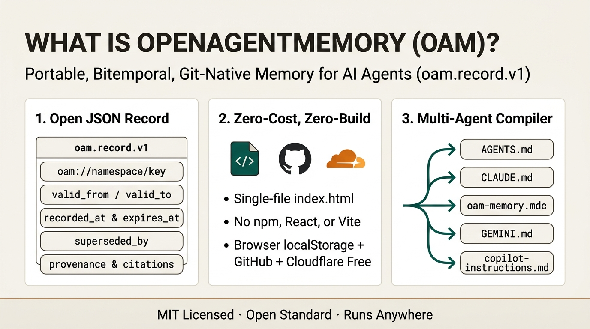
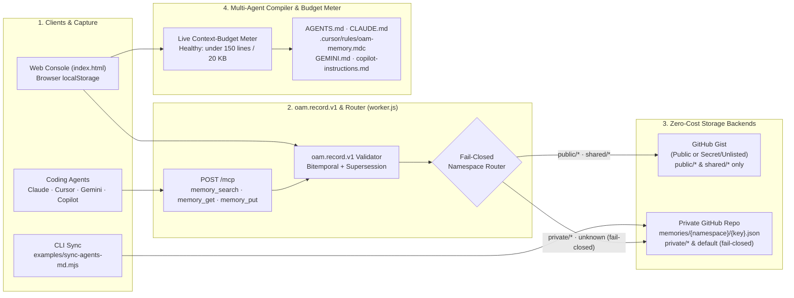
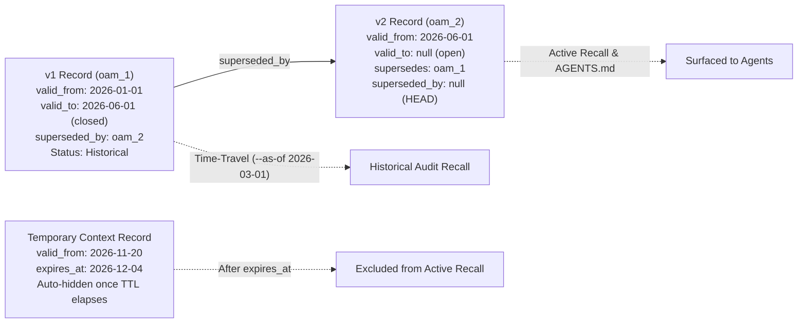

# OpenAgentMemory (OAM)

**One portable, permanent, human-readable memory for every AI assistant you use—owned by you, free forever, and ready in 3 minutes.**

> [!TIP]
> **Try It Live Right Now (Zero Sign-Up):** **[https://iggym.github.io/OpenAgentMemory/](https://iggym.github.io/OpenAgentMemory/)**  
> Opens directly in your browser with sample memories pre-loaded. Explore time-travel history, check context size with the live Bloat Meter, and export ready-to-use memory files for **Claude, Cursor, Gemini, Antigravity, Codex, and GitHub Copilot** in under 3 minutes.

[What It Is](#-01--what-is-openagentmemory) · [Utility & Value](#-02--utility--real-world-value) · [Privacy & Ownership](#-03--privacy--ownership) · [How to Use It](#-04--how-to-use-it-under-3-minutes) · [Visual Guide & Diagrams](#-05--visual-guide--architecture) · [Setup & MCP](#-06--persistence-github-pages--mcp-setup)


---

<a id="-01--what-is-openagentmemory"></a>


### The Plain-English Explanation

If you use AI assistants—whether Claude, ChatGPT, Cursor, Gemini, Antigravity, or GitHub Copilot—you have probably experienced **AI amnesia**: you explain your writing style, project rules, or key decisions in one tool, only to repeat yourself all over again the next week or in a different app.

**OpenAgentMemory (OAM)** solves that by giving you a **single, plain-file memory notebook** (`oam.record.v1`) that:

- **Belongs completely to you** — stored in your browser, your own private GitHub repository, or a free Cloudflare Worker you control.
- **Works across every AI tool** — write a preference or decision once and export it with one click into `AGENTS.md`, `CLAUDE.md`, `.cursor/rules/oam-memory.mdc`, `GEMINI.md`, or `.github/copilot-instructions.md` (or stream it live over HTTP MCP).
- **Remembers *when* things were true** — instead of silently deleting old rules when things change, OAM tracks *when* a fact started and ended (`valid_from` / `valid_to`), links new versions to old ones (`superseded_by`), and automatically hides temporary reminders after they expire (`expires_at`).
- **Costs \$0 to run and requires zero developer build tools** — the entire web app is a single `index.html` file with no `package.json`, no `npm`, no React, no paid database, and no credit card required.

> [!NOTE]
> **No technical setup required to start:** You can open **[https://iggym.github.io/OpenAgentMemory/](https://iggym.github.io/OpenAgentMemory/)** on any device and get a usable memory export in less than 3 minutes—nothing to install, no account to create.

---

<a id="-02--utility--real-world-value"></a>


### Why This Project Exists & What Value It Delivers

Most AI memory tools trap your preferences inside a single vendor's black box or dump everything into one giant Markdown file until the AI gets confused and ignores half of it. OpenAgentMemory delivers five concrete, everyday benefits:

| Everyday Problem | How OpenAgentMemory Solves It | Real-World Value |
| :--- | :--- | :--- |
| **Repeating yourself across AI tools** | **Multi-Agent Compiler** exports one clean source of truth into 5 native agent formats (`AGENTS.md`, `CLAUDE.md`, Cursor `.mdc`, `GEMINI.md`, Copilot) plus a live `/mcp` endpoint. | Stop copying and pasting the same instructions into Claude, Cursor, Gemini, and Copilot. |
| **Outdated instructions confusing your AI** | **Immutable `superseded_by` versioning & `expires_at` TTL** automatically exclude superseded rules and expired temporary notes from active exports. | Temporary reminders (like *"freeze deployments until Friday"*) vanish automatically when the deadline passes—while permanent decisions keep a full audit trail. |
| **Prompt bloat & silent context truncation** | **Live Context-Budget & Bloat Meter** tracks active records, total lines, KB size, and estimated tokens against standard 150–200 line / 20–25 KB auto-memory caps. | See immediately when your memory file is healthy (green), approaching limits (amber), or needs pruning (red). |
| **Vendor lock-in & recurring SaaS fees** | **Zero paid dependencies, zero build tools.** Plain JSON + Markdown running on browser `localStorage`, GitHub, and Cloudflare Workers Free tier. | Zero monthly bill, no credit card, and your data remains readable decades from now in plain text. |
| **"Why did the AI believe that?"** | **Bitemporal time-travel, `provenance`, and `citations`** record who added each memory, why, when it was valid, and link directly to supporting evidence. | Rewind to *"6 months ago"* to audit what was true at any point in time—great for postmortems and team onboarding. |

### Who Gets Value From OpenAgentMemory?

- **Everyday AI Power Users & Writers:** Keep your tone, formatting rules, bio, and recurring instructions in one clean browser console and paste them into any AI session in one click.
- **Solo Builders & Indie Makers:** Store project decisions in a free private GitHub repo and keep `AGENTS.md` / `CLAUDE.md` / Cursor rules synchronized without paying for memory SaaS.
- **Engineering & Product Teams:** Share public or team-wide conventions (`public/*`, `shared/*`) while keeping sensitive operational context (`private/*`) locked inside a private repository with full Git commit history and PR reviews.
- **Open-Source Maintainers & Tool Builders:** Adopt a minimal, MIT-licensed open standard (`oam.record.v1`) and plug in zero-cost storage adapters (Cloudflare D1, KV, local SQLite/JSON).

> [!TIP]
> **What should you put in OAM?** High-leverage, durable context: communication style preferences, architectural decisions (ADRs), team release workflows, repo conventions, and time-bounded operational constraints (with `expires_at`).

---

<a id="-03--privacy--ownership"></a>


### Clear Boundaries Between Shared Knowledge and Private Notes

OpenAgentMemory separates every memory by a simple prefix (**namespace**) so you always know where your data lives:

- **`public/*` & `shared/*` (The Open Shelf):** Non-sensitive team norms, open-source documentation, and shareable guidelines. When using the Cloudflare Worker router, these go to a **GitHub Gist** (public or secret/unlisted).
- **`private/*` & anything else (The Locked Vault):** Personal preferences, internal architecture, and sensitive workspace notes. These stay strictly inside your browser `localStorage`, your **Private GitHub Repository**, or an authenticated private Cloudflare backend (D1/KV).

> [!IMPORTANT]
> **Fail-Closed Privacy Rule — Never Put Private Data in Secret Gists:**  
> GitHub Gists only have **public** and **secret** visibility—there is no truly private Gist. A *secret* Gist is only **unlisted** (anyone who has the link can read it without logging in). That is why OpenAgentMemory enforces **fail-closed routing**: `private/*`—and even accidental typos like `privte/keys`—**always** route to a Private GitHub Repository (or authenticated Cloudflare D1/KV backend), never to a Gist.

---

<a id="-04--how-to-use-it-under-3-minutes"></a>


### Path A: Instant Browser Use (Under 3 Minutes — No Account or Technical Setup)

1. **Open the live app:** Visit **[https://iggym.github.io/OpenAgentMemory/](https://iggym.github.io/OpenAgentMemory/)** (or download this repo and double-click `index.html` offline).
2. **Explore the pre-loaded examples:** On first visit, 8 sample `oam.record.v1` memories are automatically saved to your browser's `localStorage` so you can see real working data immediately.
3. **Try three quick actions:**
   - Click **Try 6 mo ago** to watch bitemporal time-travel rewind memories to what was true 6 months ago.
   - Click any memory and press **Supersede** to update a rule cleanly into `v2` while preserving `v1` in version history.
   - Scroll to the **Multi-Agent Compiler**, pick your AI tool (**`AGENTS.md`**, **`CLAUDE.md`**, **`.cursor/rules/oam-memory.mdc`**, **`GEMINI.md`**, or **`.github/copilot-instructions.md`**), check the **Context-Budget Meter**, and click **Copy to Clipboard** or **Download File**.

### Multi-Agent Compiler & Live Context-Budget Meter

| Target File | Best For | Special Features |
| :--- | :--- | :--- |
| **`AGENTS.md`** | Universal (Codex, Antigravity, OpenCode, etc.) | Group by **Tag**, **Key Prefix**, or **Namespace**; includes version, provenance & citations. |
| **`CLAUDE.md`** | Claude Code | Concise bulleted rules with an optional **`@AGENTS.md` include header** toggle. |
| **`.cursor/rules/oam-memory.mdc`** | Cursor | Valid YAML frontmatter (`description`, `globs: ["**/*"]`, `alwaysApply: true`). |
| **`GEMINI.md`** | Gemini / Antigravity | Priority-ordered sections (Constraints → Decisions → Preferences → Procedures → Context). |
| **`.github/copilot-instructions.md`** | GitHub Copilot | Compact repository-level instruction bullets. |

**Context-Budget & Bloat Meter Thresholds (calculated live as you edit):**
- **Healthy (Green):** `< 150` lines and `< 20 KB`
- **Warning (Amber):** `150–200` lines or `20–25 KB` — *approaching Claude/Codex auto-memory cap; consider superseding or pruning*
- **Over Budget (Red):** `> 200` lines or `> 25 KB` — *exceeds standard agent context cap; prune or split namespace*

---

<a id="-05--visual-guide--architecture"></a>


### Infographics: What, Why & How

#### What Is OpenAgentMemory?


#### Why OpenAgentMemory?


#### How OpenAgentMemory Works


### System Diagrams (Mermaid)

#### End-to-End Architecture & Fail-Closed Routing



#### Bitemporal Validity & Immutable `superseded_by` Versioning



---

<a id="-06--persistence-github-pages--mcp-setup"></a>


### Repository Contents

| File / Folder | Purpose |
| :--- | :--- |
| [`SPEC.md`](./SPEC.md) | Complete `oam.record.v1` specification (addressing, bitemporal queries, supersession, fail-closed routing, storage layouts, exports, HTTP API). |
| [`index.html`](./index.html) | Single-file web app for GitHub Pages: Memory Console, Multi-Agent Compiler (5 formats), Live Context-Budget Meter, 3-Minute Quickstart, Spec Validator, and Private GitHub Repo / Worker backends. |
| [`worker.js`](./worker.js) | Reference zero-dependency Cloudflare Worker with REST API + HTTP `POST /mcp` JSON-RPC 2.0 tools routing `public/*` & `shared/*` to GitHub Gist and `private/*` (fail-closed) to a Private GitHub Repo. |
| [`examples/sample-memories.json`](./examples/sample-memories.json) | Sample `oam.bundle.v1` dataset covering `public/*`, `shared/*`, `private/*`, supersession chains, and TTL expiration. |
| [`examples/sync-agents-md.mjs`](./examples/sync-agents-md.mjs) | Zero-dependency Node.js CLI that reads local `memories.json` or fetches a remote URL and updates `<!-- OAM:START -->` in `AGENTS.md`. |
| [`CONTRIBUTING.md`](./CONTRIBUTING.md) | Zero-cost / zero-build philosophy, namespace privacy boundaries, and adapter contribution guidelines. |
| [`.github/ISSUE_TEMPLATE/`](./.github/ISSUE_TEMPLATE/) | Contributor templates for new storage adapters (`new-adapter.md`) and optional `oam.record.v1` fields (`schema-proposal.md`). |
| [`assets/`](./assets/) | Photorealistic editorial visuals, What / Why / How infographics, and colored SVG section banners. |
| [`LICENSE`](./LICENSE) | MIT License. |

---

### (b) Private GitHub Repo Persistence (Zero Servers)

Persist memories directly to your own private GitHub repository straight from `index.html`:

1. **Create a Private repository** on GitHub (e.g., `my-agent-memory`) and check **"Add a README file"** so `main` has an initial commit.
2. **Create a scoped Fine-Grained Personal Access Token:**
   - **GitHub → Settings → Developer settings → Personal access tokens → Fine-grained tokens → Generate new token**
   - **Repository access:** *Only select repositories* → select `my-agent-memory`
   - **Repository permissions:** set **Contents** to **Read and write** (leave everything else *No access*)
3. **Connect inside `index.html`:**
   - Click **Local Browser** in the top-right header → **Private GitHub Repo** tab.
   - Enter `your-username/my-agent-memory`, branch `main`, and your token (stored in `sessionStorage` by default).
   - Click **Test Connection** → **Push Current Records to Repo** → **Save & Activate GitHub Backend**.

Resulting clean Git repository layout:

```text
memories/
├── index.json                                # Consolidated index for single-request reads
├── private/
│   ├── preferences/agent-tone.json           # Version chain (oam.chain.v1)
│   └── architecture/storage-backend.json
└── public/
    └── architecture/zero-build-frontend.json
```

---

### (c) Host Your Own Copy on GitHub Pages (From Repo Root)

Because `index.html` requires **zero build step**, GitHub Pages serves it directly from `/`:

1. Fork or push this repository to GitHub.
2. Open **Settings → Pages**.
3. Under **Build and deployment**, choose **Deploy from a branch** → Branch **`main`**, Folder **`/ (root)`** → **Save**.
4. Visit `https://<your-username>.github.io/<your-repo-name>/`.

---

### (d) Optional: Reference Cloudflare Worker (`worker.js`) & Live HTTP `POST /mcp`

Deploy `worker.js` on the **Cloudflare Workers Free tier** (no `npm` or credit card required) to get both a REST API and a live **Model Context Protocol (MCP)** endpoint:

1. In the [Cloudflare Dashboard](https://dash.cloudflare.com/), go to **Workers & Pages → Create → Create Worker**, click **Edit code**, paste [`worker.js`](./worker.js), and click **Deploy**.
2. Under **Settings → Variables and Secrets**, add:

| Variable / Secret | Type | Description |
| :--- | :--- | :--- |
| `GITHUB_REPO` | Plaintext | Private repo for `private/*` (e.g., `your-user/my-agent-memory`). |
| `GITHUB_BRANCH` | Plaintext | Optional branch name (default `main`). |
| `GIST_ID` | Plaintext | Target GitHub Gist ID for `public/*` and `shared/*` (non-sensitive content only). |
| `REPO_TOKEN` | Secret | Fine-grained PAT scoped to `GITHUB_REPO` (`Contents: Read & Write`). |
| `GIST_TOKEN` | Secret | Classic PAT with `gist` scope (or a single `GITHUB_TOKEN` with both `repo` + `gist`). |
| `OAM_API_TOKEN` | Secret | Strong random bearer token protecting writes and non-public reads (alias: `API_KEY`). |
| `ALLOWED_ORIGIN` | Plaintext | Optional CORS origin (e.g., `https://<user>.github.io`, default `*`). |

3. **Connect MCP-Compatible Coding Agents (`POST /mcp`):**

`worker.js` implements JSON-RPC 2.0 MCP (`2024-11-05`) advertising three live tools—`memory_search`, `memory_get`, and `memory_put`—that preserve fail-closed namespace routing and automatic `superseded_by` versioning.

```json
{
  "mcpServers": {
    "open-agent-memory": {
      "url": "https://<your-worker>.workers.dev/mcp",
      "headers": {
        "Authorization": "Bearer <API_KEY>"
      }
    }
  }
}
```

Quick `curl` verification:

```bash
curl -X POST "https://<your-worker>.workers.dev/mcp" \
  -H "Content-Type: application/json" \
  -H "Authorization: Bearer <API_KEY>" \
  -d '{"jsonrpc":"2.0","id":1,"method":"tools/list"}'
```

### (e) Local CLI Sync (`examples/sync-agents-md.mjs`)

Sync local `memories.json` (or a remote Worker endpoint) into an existing `AGENTS.md` without overwriting your hand-written instructions:

```bash
node examples/sync-agents-md.mjs --input examples/sample-memories.json --output AGENTS.md
```

---

## Contributing & License

Want to propose a zero-cost storage adapter (**Cloudflare D1**, **Cloudflare KV**, **local SQLite/JSON**) or an optional `oam.record.v1` field? Read [`CONTRIBUTING.md`](./CONTRIBUTING.md) and open an issue using our [New Adapter](./.github/ISSUE_TEMPLATE/new-adapter.md) or [Schema Proposal](./.github/ISSUE_TEMPLATE/schema-proposal.md) templates.

Released under the [MIT License](./LICENSE).
