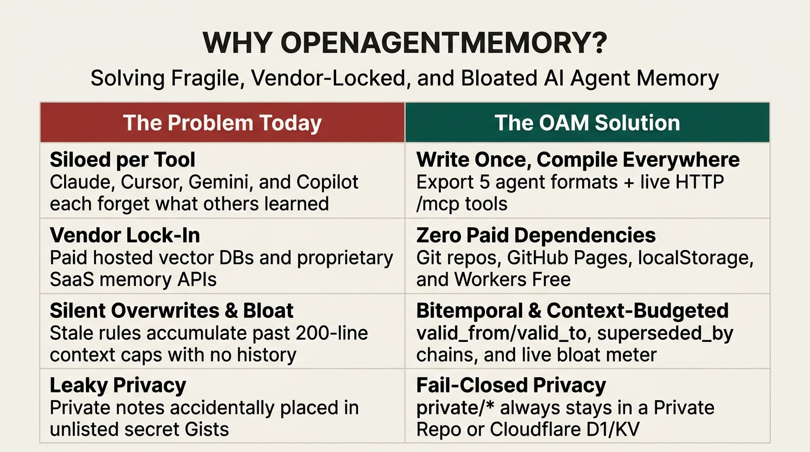
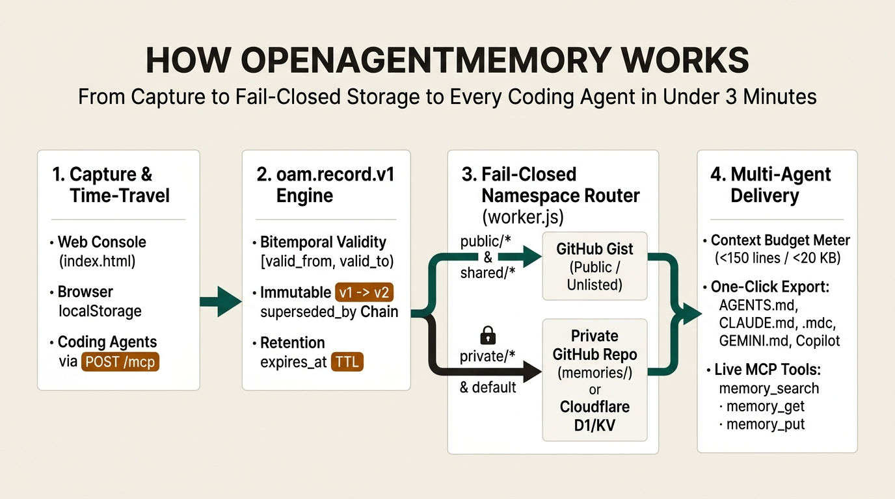
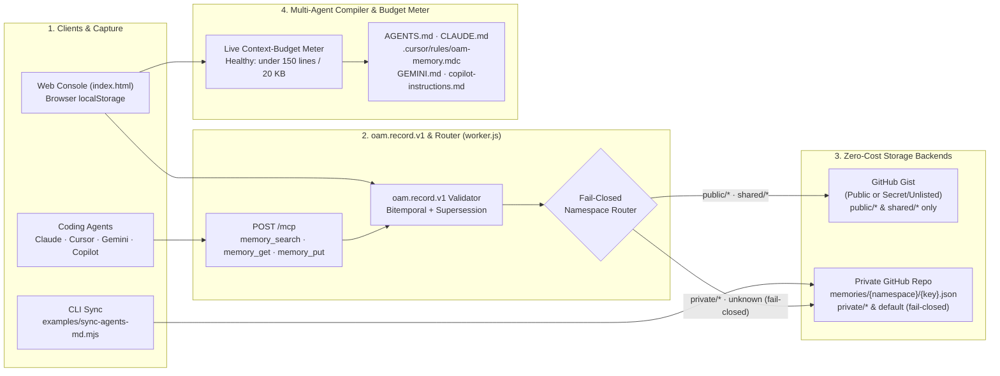
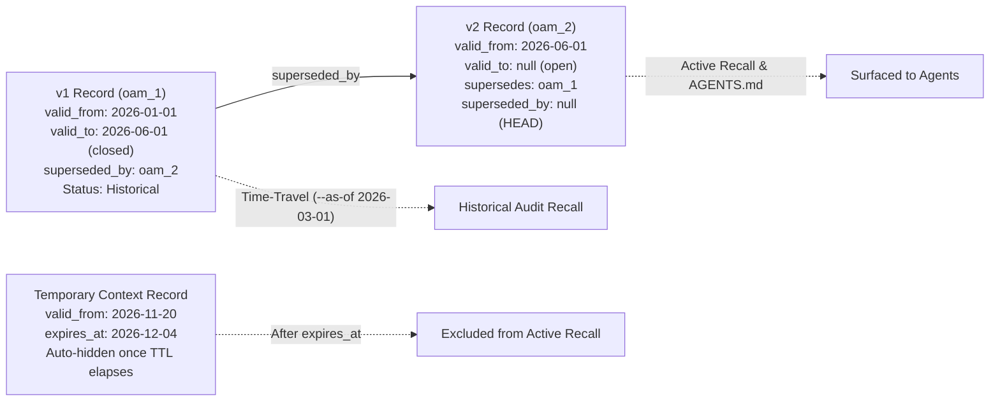

# OpenAgentMemory (OAM)

**Portable, bitemporal, Git-native memory for AI agents.**

> **Live Website & Interactive Console:** **[https://iggym.github.io/OpenAgentMemory/](https://iggym.github.io/OpenAgentMemory/)**  
> Launch in your browser right now—sample memories are pre-seeded in `localStorage` so you can time-travel, supersede, check context budgets, and export `AGENTS.md` / `CLAUDE.md` / `.mdc` / `GEMINI.md` / Copilot rules in under 3 minutes with zero accounts or API keys.

- **Zero paid dependencies** — runs on browser `localStorage`, free GitHub repos/Gists, GitHub Pages, and Cloudflare Workers Free tier.
- **Zero build tools & zero frameworks** — plain vanilla HTML, CSS, and modern JavaScript (no `package.json`, `npm`, React, TypeScript, or Vite).
- **Bitemporal & auditable** — tracks domain validity (`valid_from`, `valid_to`), system recording time (`recorded_at`), retention TTL (`expires_at`), immutable `superseded_by` version chains, `provenance`, and `citations`.
- **Fail-closed namespace routing** — `public/*` and `shared/*` route to a GitHub Gist; `private/*` and every unrecognized namespace route exclusively to a private GitHub repository (or authenticated Cloudflare D1/KV backend).
- **Multi-agent ready** — one-click compiler for 5 agent formats + live Context-Budget & Bloat Meter + lightweight HTTP `POST /mcp` JSON-RPC 2.0 server.

---

## What, Why & How (Visual Guide)

### What is OpenAgentMemory?


### Why OpenAgentMemory?



### How OpenAgentMemory Works



---

## Architecture & Lifecycle Diagrams

### End-to-End Architecture & Fail-Closed Routing



### Bitemporal Validity & Immutable `superseded_by` Versioning



---

## Repository Contents

| File | Purpose |
| :--- | :--- |
| [`SPEC.md`](./SPEC.md) | Complete `oam.record.v1` specification (addressing, bitemporal queries, supersession, routing, storage layout, exports, HTTP API). |
| [`index.html`](./index.html) | Single-file web application for GitHub Pages: embedded spec overview, 3-minute quickstart, live memory console, time-travel queries, Multi-Agent Compiler (5 formats), Live Context-Budget Meter, Private GitHub Repo & Cloudflare Worker backends, and JSON import/export. |
| [`worker.js`](./worker.js) | Reference zero-dependency Cloudflare Worker with REST API + HTTP `POST /mcp` JSON-RPC 2.0 tools routing `public/*` & `shared/*` to a GitHub Gist and `private/*` (fail-closed default) to a Private GitHub Repository. |
| [`assets/`](./assets/) | What / Why / How editorial infographics (`oam-what.jpg`, `oam-why.jpg`, `oam-how.jpg`). |
| [`examples/sample-memories.json`](./examples/sample-memories.json) | Sample `oam.bundle.v1` dataset covering `public/*`, `shared/*`, `private/*`, supersession chains, and TTL expiration. |
| [`examples/sync-agents-md.mjs`](./examples/sync-agents-md.mjs) | Zero-dependency Node.js script that reads local `memories.json` or fetches a remote endpoint and updates the `<!-- OAM:START -->` block in `AGENTS.md`. |
| [`CONTRIBUTING.md`](./CONTRIBUTING.md) | Zero-cost / zero-build philosophy, namespace privacy rules, and adapter contribution guidelines. |
| [`.github/ISSUE_TEMPLATE/`](./.github/ISSUE_TEMPLATE/) | Templates for proposing new storage adapters (`new-adapter.md`) and optional `oam.record.v1` fields (`schema-proposal.md`). |
| [`LICENSE`](./LICENSE) | MIT License. |

---

## (a) Instant Browser Use (Under 3 Minutes — No Accounts or Keys)

1. **Open the console** directly in any modern browser:
   - **Hosted (live):** open **[https://iggym.github.io/OpenAgentMemory/](https://iggym.github.io/OpenAgentMemory/)**.
   - **Locally:** clone or download this repository and double-click `index.html` (or serve it with `python3 -m http.server 8000`).
2. **Explore immediately:** On initial load, `index.html` automatically seeds sample `oam.record.v1` memories into `localStorage` (`oam.records.v1`), including active records, a `superseded_by` version chain, a historical bitemporal record, and a record with an `expires_at` TTL.
3. **Try core workflows:**
   - Click **Try 6 mo ago** to see bitemporal time-travel rewind memories to their historically valid versions.
   - Select any memory and click **Supersede** to create a linked `v(n+1)` version while preserving lineage.
   - Use the **Multi-Agent Compiler** (with the live Context-Budget Meter) to copy or download **`AGENTS.md`**, **`CLAUDE.md`**, **`.cursor/rules/oam-memory.mdc`**, **`GEMINI.md`**, or **`.github/copilot-instructions.md`**.

---

## (b) Private GitHub Repo Persistence

Persist your memories directly to a private GitHub repository straight from `index.html`—no server required.

### 1. Create a Private Memory Repository

1. On GitHub, create a new **Private** repository (for example, `my-agent-memory`).
2. Check **"Add a README file"** so the `main` branch is initialized with a first commit.

### 2. Create a Scoped Fine-Grained Personal Access Token

1. Go to **GitHub → Settings → Developer settings → Personal access tokens → Fine-grained tokens → Generate new token**.
2. Under **Repository access**, select **Only select repositories** and choose your private memory repo (`my-agent-memory`).
3. Under **Permissions → Repository permissions**, set **Contents** to **Read and write** (leave all other permissions as *No access*).
4. Generate and copy the token (`github_pat_...`).

### 3. Connect Inside `index.html`

1. Click **Local Browser** in the top-right header of `index.html` to open **Storage Backend**.
2. Select the **Private GitHub Repo** tab.
3. Enter:
   - **Repository:** `your-username/my-agent-memory`
   - **Branch:** `main`
   - **Fine-Grained PAT:** paste your token (stored in `sessionStorage` by default; check *Remember token* only on trusted personal devices).
4. Click **Test Connection**, then **Push Current Records to Repo** (or **Pull from Repo**), and click **Save & Activate GitHub Backend**.

### Resulting Git Repository Layout

Every write commits clean, reviewable JSON directly to your repo:

```text
memories/
├── index.json                                # Consolidated index for O(1) reads
├── private/
│   ├── preferences/agent-tone.json           # Version chain (oam.chain.v1)
│   └── architecture/storage-backend.json
└── public/
    └── architecture/zero-build-frontend.json
```

---

## (c) Enabling GitHub Pages from the Repo Root

Because `index.html` requires **zero build step**, GitHub Pages serves it directly from the repository root:

1. Push (or fork) this repository to GitHub.
2. Open your repository on GitHub and click **Settings**.
3. In the left sidebar, click **Pages**.
4. Under **Build and deployment**:
   - **Source:** `Deploy from a branch`
   - **Branch:** `main` (or your default branch)
   - **Folder:** `/ (root)`
5. Click **Save**.
6. Wait ~30–60 seconds and visit:
   ```text
   https://<your-username>.github.io/<your-repo-name>/
   ```

---

## (d) Optional: Reference Cloudflare Worker (`worker.js`)

Use `worker.js` when you want an HTTP API for CLI scripts, coding agents, or cross-device sync that automatically separates visibility by namespace:

- `public/*` and `shared/*` → **GitHub Gist** (public or secret/unlisted—non-sensitive content only)
- `private/*` and all unrecognized namespaces → **Private GitHub Repository** (or an authenticated Cloudflare backend such as D1/KV)

> **Security Note on GitHub Gists:** GitHub Gists only support **public** and **secret** visibility—there is no truly private Gist. A *secret* Gist is only **unlisted** (readable by anyone with the URL). Never store sensitive or private memories in a secret Gist; `worker.js` enforces fail-closed routing so `private/*` and unknown namespaces always go to your Private GitHub Repository (or a private Cloudflare D1/KV adapter).

### Deploy Without `npm` (Cloudflare Dashboard — Free Tier)

1. Sign in to the [Cloudflare Dashboard](https://dash.cloudflare.com/) → **Workers & Pages** → **Create** → **Create Worker**.
2. Name the worker (e.g., `open-agent-memory`) and click **Deploy**.
3. Click **Edit code**, replace the default script with the full contents of [`worker.js`](./worker.js), and click **Deploy**.
4. Go to **Settings → Variables and Secrets** and add:

| Variable / Secret | Type | Description |
| :--- | :--- | :--- |
| `GITHUB_REPO` | Plaintext | Private repo for `private/*` (e.g. `your-user/my-agent-memory`). |
| `GITHUB_BRANCH` | Plaintext | Optional branch name (default `main`). |
| `GIST_ID` | Plaintext | Target GitHub Gist ID for `public/*` and `shared/*` (create a Gist with a placeholder file first). |
| `REPO_TOKEN` | Secret | Fine-grained PAT scoped to `GITHUB_REPO` (`Contents: Read & Write`). |
| `GIST_TOKEN` | Secret | Classic PAT with `gist` scope (or set a single `GITHUB_TOKEN` with both `repo` + `gist`). |
| `OAM_API_TOKEN` | Secret | Strong random bearer token protecting writes and non-public reads. |
| `ALLOWED_ORIGIN` | Plaintext | Optional CORS origin (e.g. `https://<user>.github.io`, default `*`). |

5. Verify deployment:
   ```bash
   curl https://open-agent-memory.<your-subdomain>.workers.dev/health
   ```
6. Connect `index.html` by opening **Storage Backend → Cloudflare Worker**, entering your Worker URL + `OAM_API_TOKEN` (or `API_KEY`), and clicking **Test /health** → **Save & Activate**.

### Connect MCP-Compatible Coding Agents (`POST /mcp`)

`worker.js` exposes a lightweight **JSON-RPC 2.0 MCP endpoint** at `POST /mcp` (protocol `2024-11-05`) with three live memory tools—`memory_search`, `memory_get`, and `memory_put`—that preserve fail-closed namespace routing (`public/*` & `shared/*` → Gist; `private/*` & default → Private GitHub Repo).

Paste this configuration into your MCP-compatible coding agent (Claude Code, Cursor, Antigravity, etc.):

```json
{
  "mcpServers": {
    "open-agent-memory": {
      "url": "https://<your-worker>.workers.dev/mcp",
      "headers": {
        "Authorization": "Bearer <API_KEY>"
      }
    }
  }
}
```

> Omit `"headers"` if you have not configured `OAM_API_TOKEN` / `API_KEY` (or for public-only reads when `PUBLIC_READ_OPEN` is enabled).

Quick `curl` test against `/mcp`:

```bash
curl -X POST "https://<your-worker>.workers.dev/mcp" \
  -H "Content-Type: application/json" \
  -H "Authorization: Bearer <API_KEY>" \
  -d '{"jsonrpc":"2.0","id":1,"method":"tools/list"}'
```

---

## Multi-Agent Compiler & Live Context-Budget Meter (`index.html`)

Inside `index.html`, the **Multi-Agent Compiler** compiles active (non-superseded, non-expired) records for the selected namespace into five ready-to-use agent formats with one-click **Copy to Clipboard** and **Download File**:

- `AGENTS.md` (Universal — grouped by tag, key prefix, or namespace, with version, provenance, and citations)
- `CLAUDE.md` (Claude Code — concise bulleted rules with optional `@AGENTS.md` include header toggle)
- `.cursor/rules/oam-memory.mdc` (Cursor MDC with YAML frontmatter)
- `GEMINI.md` (Gemini / Antigravity structured priority sections)
- `.github/copilot-instructions.md` (Compact repository-level Copilot instructions)

The real-time **Context-Budget & Bloat Meter** tracks active record count, total lines, size in KB, and estimated tokens against standard auto-memory caps:

- **Healthy (Green):** `< 150` lines and `< 20 KB`
- **Warning (Amber):** `150–200` lines or `20–25 KB` (*approaching Claude/Codex auto-memory cap*)
- **Over Budget (Red):** `> 200` lines or `> 25 KB` (*prune or split namespace*)

---

## License

Released under the [MIT License](./LICENSE).
